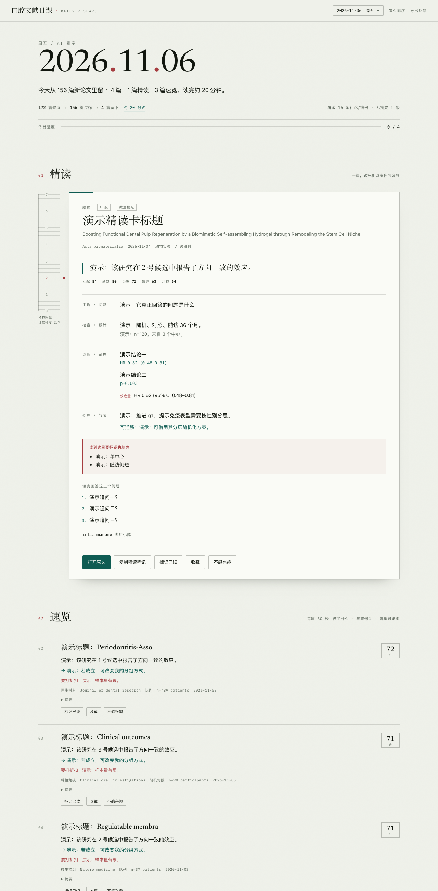
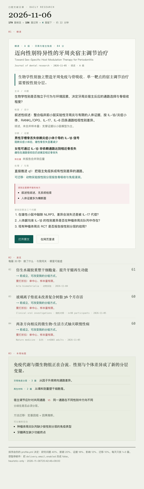

# 口腔文献日课 · Daily Research

每天 **2 篇精读 + 8 篇速览**，从 150–250 篇新论文里筛出来。
GitHub Actions 每天 07:30 自动跑：**一封邮件 + 一个网页**，内容是同一份结果；你在页面上读、标记、否决，反馈回流到下一次筛选。

旧版界面保留在 [`legacy/index.html`](legacy/index.html)。



<sub>上图：接入模型后的四段式精读卡（内容为演示数据，仅示意结构）。</sub>



<sub>上图：每天 07:30 的邮件（演示数据）。</sub>

---

## 为什么改

旧版的问题是三个，而不是一个：

| 问题 | 旧版 | 现在 |
|---|---|---|
| 检索太多 | 14 本期刊 × 每次抓 6 篇，仍会堆出几十篇 | 召回 150–250 篇 → 确定性粗排 → 模型精排 → **只留 10 篇** |
| 无法消化 | 每篇都给一段"方法概要 + 中文标题 + 术语表"，读完仍然记不住 | 2 篇精读卡按 **主诉 / 检查 / 诊断 / 处理** 四段组织，附效应量、局限、三个追问；其余 8 篇只给 30 秒版 |
| 不知道 match 我 | Taste 是关键词权重，"相关"不等于"推进我的问题" | 你的 5 个研究问题写进 `profile.yml`，每篇都要回答"它推进了哪一条" |

另外两个结构性变化：

- **不再是"点一下现场检索"**：每天自动生成、写入 `data/daily/`，页面打开即读，手机上也能看。
- **API Key 不进浏览器**：Key 存在仓库 Secrets，网页是纯静态的。

---

## 每天怎么用（约 40 分钟）

1. **看漏斗**：`172 篇候选 → 156 篇过筛 → 10 篇留下`。数字本身就是信息——今天确实只有 10 篇值得读。
2. **精读**（每篇 12–15 分钟，共 2 篇）：按四段读。读完先回答卡片底部的 **三个追问**，再点「标记已读」。
   - 「要打折扣」那一段是让你别全信的：体外高浓度、单中心回顾、n<30 都会写在这里。
3. **速览**（8 篇，每篇 30 秒）：一句话 + 对我何关 + 哪里可能虚。八篇刻意跨期刊、跨主题，避免你连续三天读同一个课题。
4. **不感兴趣**：点掉。周末在页面右上角「导出反馈」，把 JSON 放进 `feedback/inbox/`，下次运行会永久屏蔽。
5. **周日**：多出「本周地图」——主题簇、争议双方、方法迁移、三个可做的空白。

---

## 接入（3 步，约 5 分钟）

1. **拿 Key**：到 [platform.agnes-ai.com](https://platform.agnes-ai.com) 注册 → API Keys → 新建；质检还需要 [OpenCode Go](https://opencode.ai/console) 的 `OPENCODE_API_KEY`（见下文「质检与自动修复」）。
   模型用 `agnes-2.5-flash`（OpenAI 兼容，当前限免；价格以 [官方定价页](https://agnes-ai.com/docs/pricing) 为准）。
2. **存 Secret**：本仓库 `Settings → Secrets and variables → Actions → New repository secret`
   - Name: `AGNES_API_KEY`（也兼容你已有的 `AGNES`）｜Secret: 你的 Agnes Key
   - Name: `OPENCODE_API_KEY`（可选，质检 + MiMo 重写）｜Secret: OpenCode Go 的 Key
   - Name: `RESEND_API_KEY`（可选，邮件）｜Secret: Resend 的 Key
3. **开权限并试跑**：`Settings → Actions → General → Workflow permissions` 选 **Read and write**；
   然后 `Actions → daily-digest → Run workflow` 手动跑一次。

Pages 保持 `Settings → Pages → Deploy from a branch → main / (root)` 即可，工作流提交后自动发布。

> 第一次运行前，页面会显示"未接入模型"：只有确定性排序，没有精读卡。这是预期状态，不是故障。

---

## 邮件推送

默认每天 07:30 把当天十篇发到 **lnz985211@gmail.com**（收件人在 `config/profile.yml → delivery.email.to`，可改）。

### 推荐：Resend（约 5 分钟）

1. 用 `lnz985211@gmail.com` 注册 [resend.com](https://resend.com)（免费 100 封/天）
2. `API Keys → Create API Key`，复制 `re_` 开头的 Key
3. 仓库 `Settings → Secrets and variables → Actions` 新建 `RESEND_API_KEY`

发件人保持默认 `onboarding@resend.dev`。Resend 的测试发件人有限制：**只能发给注册账号自己的邮箱**——这里正好是发给自己，不需要买域名、不需要验证 DNS。

### 备选：Gmail / QQ 邮箱 SMTP

不想注册 Resend，就用自己邮箱发（邮件会出现在「已发送」里）：

| Secret | Gmail | QQ 邮箱 |
|---|---|---|
| `SMTP_HOST` | `smtp.gmail.com` | `smtp.qq.com` |
| `SMTP_PORT` | `465` | `465` |
| `SMTP_USER` | 你的邮箱地址 | 你的邮箱地址 |
| `SMTP_PASS` | Google 应用专用密码 | 邮箱「授权码」 |

Gmail 要先开两步验证才能生成[应用专用密码](https://myaccount.google.com/apppasswords)。
同时把 `profile.yml` 里的 `from` 改成你的邮箱，否则 Gmail 会拒信。

### 行为

- 没配任何凭据：自动跳过，只在日志里写一行，**不影响**流水线；
- `send_when_empty: false`：当天没有过筛论文就不发；
- HTML + 纯文本双版本，手机邮件客户端可读；
- 周日多一段「本周地图」；
- 发信失败不会让当天的数据丢失（数据先落盘、再发信）。

---

## 质检与自动修复

每张精读卡生成后要过三道关，全部记录在 `deep.quality` 里，页面和邮件都会显示「质检 92 · 已重写」这类标记。

| 层 | 谁来做 | 查什么 | 失败后 |
|---|---|---|---|
| 1. 规则质检 | 本地代码，无需 Key | 字段为空/占位符、证据不足 2 条、追问不足、文本截断、多条证据文案重复 | 进第 2 层 |
| 2. 评委复核 | OpenCode Go（默认 `glm-5.3-flash`） | 完整性、是否忠实于摘要（禁止编造数字）、是否具体 | 进第 3 层 |
| 3. 重写 | OpenCode Go（`mimo-v2.6-flash`） | 带着前两层的 `problems` 重新生成，再走一次规则质检 + 评委 | 仍不过就标记「质检未过」 |

### 需要加一个 Secret

`OPENCODE_API_KEY`（Settings → Secrets and variables → Actions）。

获取方式：登录 [OpenCode Console](https://opencode.ai/console)，订阅 Go（$10/月），在 Console 复制 API key。模型走 OpenAI 兼容端点：

```
https://opencode.ai/inference/go/openai/v1
model: glm-5.3-flash   # 质检
model: mimo-v2.6-flash # 重写
```

没有这个 Key 时，第 1 层规则质检仍然工作，只是不会调用评委、也不会自动重写；卡片上会显示规则质检的分数。

### 修复已经生成的那一天

如果某天的卡片已经坏了，不用等下一班：

- **网页操作**：Actions → `repair-digest` → Run workflow → 填日期（如 `2026-11-11`）
- **本地**：

```bash
export OPENCODE_API_KEY=...
python -m pipeline.repair --date 2026-11-11
python -m pipeline.repair --date 2026-11-11 --dry-run   # 只看分数，不写文件
```

只重写没过质检的卡片，通过的保持原样；修完会重写 `data/`、`notes/`，Pages 自动更新。

---

## 调参：只改一个文件

`config/profile.yml` 是你唯一需要长期维护的文件。

| 字段 | 作用 | 建议 |
|---|---|---|
| `research_questions` | **最重要**。每篇论文都会被问"它推进了哪一条" | 3–5 条，写成可回答的句子，不要写"口腔医学" |
| `quota` | 每天精读/速览/回看的数量 | 默认 **2+8**；忙的时候改成 1+4 |
| `sources.journals` | 期刊白名单，分 A/B 级 | 每季度删掉你从不点开的刊 |
| `scoring.weights` | 五维权重 | 想更看重方法学就把 `rigor` 调高 |
| `negative_patterns` | 明确不想看的类型 | 命中会扣分，不是硬过滤 |

改完直接提交，下一次运行生效。`--dry-run` 可以先看排序结果再决定。

---

## 排序口径

```
确定性粗排（无模型，永远可跑）
  ├─ 期刊层级 A/B/C        → 0–15
  ├─ 设计类型（PubMed 类型优先于摘要关键词）
  ├─ 样本量 log10 归一化    → 0–8
  ├─ 新鲜度 + 主题命中      → 0–43
  └─ 负面模式扣分           → −25
        ↓ 取前 36 篇
模型精排（agnes-2.5-flash，每批 12 篇）
  match 40 · novelty 20 · rigor 18 · impact 12 · transfer 10
        ↓ 最终 = 0.78 × 模型加权分 + 0.22 × 粗排分
配额 + 多样性约束（不重复期刊/主题）→ 2 精读 + 8 速览
```

模型不可用时自动降级为纯确定性排序，流水线不会挂。`state/seen.json` 做 120 天去重，`state/backlog.json` 让没读的速览在「待回看」里按等待天数轮转。

---

## 本地运行

```bash
python3 -m venv .venv && source .venv/bin/activate
pip install -r requirements.txt

export AGNES_API_KEY=sk-...        # 不设也能跑，只是没有精读卡
python -m pipeline.main --dry-run  # 只看排序，不写文件
python -m pipeline.main            # 写入 data/ notes/ state/

python -m unittest discover -s tests -v   # 28 个离线测试
python -m http.server 8000                # 打开 http://localhost:8000
```

也可以把 Key 写进 `.env.local`（已在 `.gitignore` 里），本地运行会自动读取。

---

## 目录

```
config/profile.yml        研究画像：问题、期刊、配额、权重
pipeline/fetch.py         PubMed 检索（E-utilities）+ XML 解析
pipeline/score.py         设计识别、样本量、粗排、配额选择
pipeline/analyze.py       模型提示词：批评分 / 精读 / 周报
pipeline/llm.py           Agnes 客户端（OpenAI 兼容，含 JSON 修复）
pipeline/render.py        每日 JSON、Markdown 笔记、索引、状态
pipeline/main.py          编排 + CLI
data/daily/*.json         每日结果（网页读这个）
data/index.json           日期索引
notes/*.md                Obsidian 友好的每日笔记
state/seen.json           去重
state/backlog.json        待回看
feedback/inbox/           你导出的反馈
assets/app.js|app.css     前端（无构建、无框架）
legacy/index.html         旧版单页应用
```

---

## 常见问题

**为什么今天没更新？**
GitHub 定时任务可能延迟 10–30 分钟；也可能当天没有过筛的新论文（周末更常见，所以默认回看 3 天）。可在 Actions 里手动触发。

**会花钱吗？**
`agnes-2.5-flash` 目前限免，一次运行约 5 次调用、2 万 token 上下。免费策略随时可能变，请以官方定价页为准；换模型只需改 `profile.yml` 的 `llm.base_url` 与 `model`。

**Key 安全吗？**
Key 只在 Actions 运行时注入环境变量，不写进仓库、不进浏览器。网页端没有任何 Key 输入框。

**模型会不会瞎编？**
精读提示词强制要求"摘要未说明"就写"摘要未说明"，并禁止编造数字；但摘要级判断仍有误判，所以卡片保留「要打折扣」与原文链接每天复核。反馈与 `profile.yml` 是纠正它的主要手段。

**旧的 Taste 数据怎么办？**
旧版存在浏览器 localStorage，不会自动迁移。把你在意的方向写进 `research_questions` 即可，效果比关键词权重更直接。

---

## License

MIT
